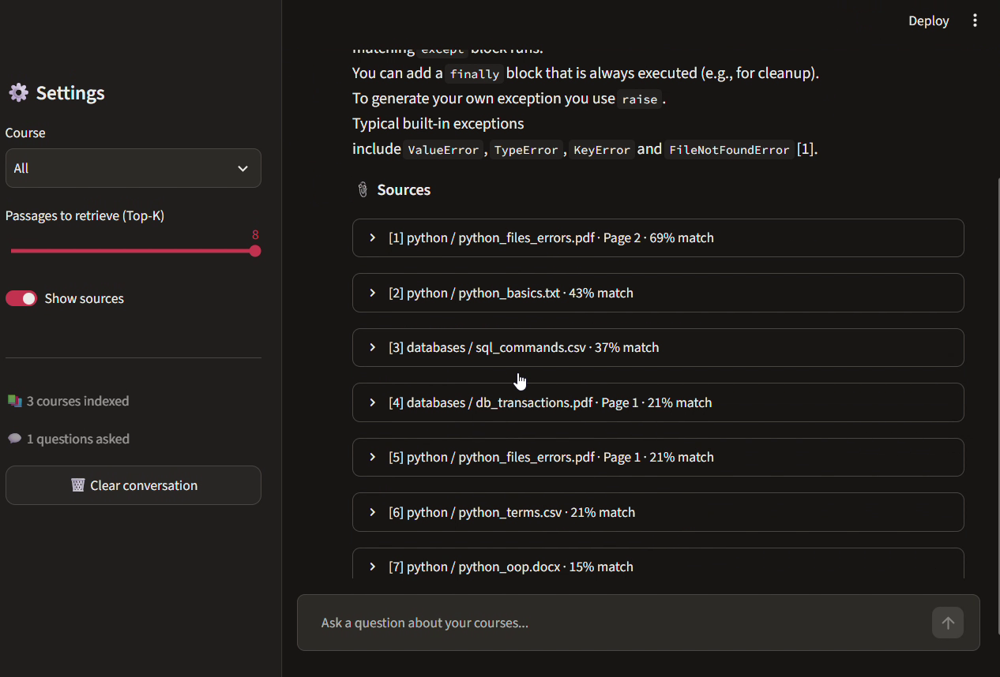

# Standard Course Q&A RAG System

Answers students' questions using only their course files. It retrieves the most relevant passages with multilingual embeddings and ChromaDB, asks an LLM to answer from them with citations, and shows the sources in a Streamlit app.



Demo video: [demo.mp4](demo.mp4)

## Features

- Reads PDF, DOCX, TXT and CSV files, one folder per course
- Searches all courses or one selected course
- Adjustable number of retrieved passages (2 to 8)
- Shows file, page, match score and full text for every source
- Instructed to answer in the language of the question, and to say so when the answer is not in the materials

## How it works

1. **Ingest** (`ingest.py`): extracts and cleans text, splits it into chunks of up to 800 characters with a 150-character overlap, embeds them with `paraphrase-multilingual-MiniLM-L12-v2`, and stores them in ChromaDB with cosine distance.
2. **Retrieve** (`rag.py`): embeds the question and fetches the top-K chunks, optionally filtered by course.
3. **Generate** (`rag.py`): sends the chunks to the LLM with instructions to use only that context and cite passages as [1], [2].

## LLM providers

Set `PROVIDER` in `rag.py`. The default is Groq.

| `PROVIDER` | Key in `.env` | Extra package |
|---|---|---|
| `groq` (default) | `GROQ_API_KEY` | – |
| `openrouter` (set the model name first) | `OPENROUTER_API_KEY` | – |
| `gemini` | `GEMINI_API_KEY` | `google-genai` |
| `ollama` (local) | – | `ollama` |
| `claude` | `ANTHROPIC_API_KEY` | `anthropic` |

## Run it

Requires Python 3.10 or newer.

```bash
pip install -r requirements.txt
```

Copy `.env.example` to `.env` and add your key, then:

```bash
python make_sample_data.py
python ingest.py
streamlit run app.py
```

`make_sample_data.py` creates three sample courses (Python, machine learning, databases). To use your own files, put them in `data/<course name>/` and run `ingest.py` again. Ingest must run before the app, because the app opens the existing database.

## Limitations

- Retrieval can miss answers that are in the files. In the demo, "What is overfitting?" is not answered although `ml_intro.txt` defines it. A likely cause is that chunks are longer than the embedding model's input limit, so the end of a chunk is ignored.
- Scanned PDFs are not supported, because there is no OCR.
- Text inside DOCX tables is not extracted.
- Each question is answered on its own, without the earlier conversation.

## Structure

```
├── app.py                 Streamlit interface
├── rag.py                 retrieval and LLM calls
├── ingest.py              builds the vector database
├── make_sample_data.py    creates sample course files
├── assets/
├── demo.mp4
├── requirements.txt
└── .env.example
```
